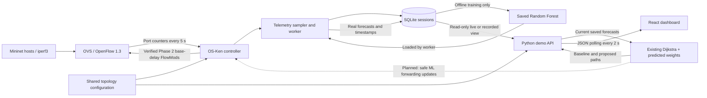

# FlowRider faculty demo review

**Recommended presentation: Replay.** It uses the real, validated Phase 3
Mininet recording and saved forecasts. No Mininet, sudo, model training or
Internet access is needed after the installed frontend dependencies are present.
All dashboard times are displayed in **IST**; the original UTC timestamps remain
in the API and database.

## A. Exact startup and shutdown

### Replay: one command

```bash
cd ~/Flowrider
bash scripts/start_demo.sh replay
```

Open **http://localhost:8080** in the Windows or Ubuntu browser. Leave the
terminal running. The script builds React and starts one Python process serving
both the API and dashboard. Press **Ctrl+C in that terminal** to stop it.
It does not start, stop or replace the SDN controller or Mininet.

If port 8080 is occupied, use `bash scripts/start_demo.sh replay --port 8081`
and open `http://localhost:8081`. Do not kill an unfamiliar service.

Use **Start replay**, **Pause**, **Reset**, **Next event**, the timeline slider
and 1×/2×/4× speed. Next event jumps to an actual saved forecast-warning event.
Reset pauses at the beginning and restores the h1→h4 route selection. Neither
control changes the dataset. Clicking a link opens its inspector; clicking a
switch selects it as the destination for a route preview.

The amber dashed route is **proposed only**. The cyan route is the calculated
base-delay controller policy. Neither is a packet-path capture or proof of an
installed flow. The dashboard never sends OpenFlow updates.

### Live: optional three terminals

Replay is sufficient for the review. Only attempt live if there is time and
sudo is available. Exit any **owned** Mininet lab before starting another with
the same switch names. The existing controller on port 6653 may stay running;
the following commands use port **16653**.

Terminal 1 — controller with telemetry and the existing trained model:

```bash
cd ~/Flowrider
~/.pyenv/versions/3.10.16/bin/python -u controller.py \
  --ofp-listen-host 127.0.0.1 --ofp-tcp-listen-port 16653 \
  --telemetry-enabled --telemetry-db "$PWD/data/demo-live.sqlite" \
  --telemetry-model "$PWD/data/research-20261015T180515Z/evaluation/model.pkl"
```

Terminal 2 — existing Mininet topology:

```bash
cd ~/Flowrider
sudo /usr/bin/python3 mininet_topology.py --controller-port 16653
```

At `mininet>`:

```text
pingall
h4 sh -c 'iperf3 -s -p 5201 >/tmp/flowrider-demo-h4.log 2>&1 & echo $! >/tmp/flowrider-demo-h4.pid'
h6 sh -c 'iperf3 -s -p 5201 >/tmp/flowrider-demo-h6.log 2>&1 & echo $! >/tmp/flowrider-demo-h6.pid'
h1 iperf3 -c 10.0.0.4 -u -b 95M -t 60 -i 5 >/tmp/flowrider-demo-h1.log 2>&1 &
h3 iperf3 -c 10.0.0.6 -u -b 95M -t 60 -i 5
```

These are two finite UDP flows in the isolated lab. Ring links are 100 Mbps,
the backbone is 200 Mbps; both flows use the backbone. Allow about 20 seconds
for valid lag history before expecting predictions. Measured links should turn
red at 80%. A forecast warning is **not guaranteed**; this is the actual model.

Terminal 3 — dashboard/API:

```bash
cd ~/Flowrider
bash scripts/start_demo.sh live --live-db "$PWD/data/demo-live.sqlite"
```

Open **http://localhost:8080**. The LIVE/REPLAY buttons switch the view in the
same running dashboard. In LIVE, Start means **Refresh live**; it does not start
traffic or grant root access. Missing/stale live measurements display `—`, not
recorded values or fabricated zeros. Controller health is inferred from fresh
telemetry, not a direct verified switch-session query.

Shutdown: let the 60-second clients finish. In the owned Mininet CLI, verify the
saved server PIDs with `h4 ps -p PID -o pid,args` / `h6 ps -p PID -o pid,args`,
then stop only those verified iperf3 PIDs. Type `exit` to let Mininet stop its
owned network. Ctrl+C the controller and dashboard in their own terminals.
Do not use global `mn -c` or `pkill` against unrelated services.

### Setup notes

The existing Python 3.10.16 environment already has NetworkX, OS-Ken and the ML
dependencies. The API adds **no Python dependency**. Node/npm are available;
the startup script uses the lockfile if frontend packages need installing.
No virtual environment or additional controller is required.
On first startup the script makes `data/demo-replay.sqlite` using SQLite's
backup API, including committed WAL data, while leaving the original experiment
unchanged. This standalone replay copy remains usable after a WSL restart.

## B. Three-minute presentation script

**0:00–0:30 — problem and objective**

“A fixed shortest path may become busy while another path still has capacity.
FlowRider studies whether recent network measurements can help us predict high
link utilization and suggest a better route. Our aim is predictive congestion
avoidance. We have not yet proved a routing-performance improvement.”

**0:30–1:00 — architecture**

“Mininet creates six hosts, six OVS switches and seven links. OS-Ken controls
the switches using OpenFlow 1.3. It polls port counters every five seconds.
We store valid measurements in SQLite. A Random Forest model uses recent link
history to predict utilization about 15 seconds ahead.”

**1:00–1:45 — dashboard and prediction**

Choose **REPLAY**, click **Reset**, then **Next event**. Inspect **s2-s5**.

“This is a recording of real Mininet traffic, not newly generated live traffic.
The original timestamps are visible. Each link shows measured utilization and
the saved future prediction. Red means measured utilization is at least 80%.
Amber forecasts indicate a predicted threshold crossing. Next Event uses a
saved model warning; it does not invent or alter measurements.”

Click **Start replay** to show real changes, then **Pause**. Scroll to the link
inspector if necessary. The dashed chart values are plotted at their forecast
target times; actual measurements are shown only up to the replay cursor.

**1:45–2:30 — routing calculation**

“The blue path is the baseline controller policy. The amber dashed path is an
ML-weighted proposal. We calculate each link's cost as
W = D₀ × (1 + 25 × predicted utilization to the power four).
D₀ is configured link delay. The penalty rises sharply near full utilization.
Dijkstra finds the path with the lowest total cost. These values are routing
costs, not measured end-to-end latency.”

Click **Recalculate preview**. If both paths coincide, use **Next event**; a
different path is available in the recording. Change source/destination or click
a switch to demonstrate that the routing calculation is interactive.

“The current dashboard does not install this proposed path. The verified OS-Ken
controller still forwards using its base-delay policy and handles link failures.”

**2:30–3:00 — evidence and limits**

“Phase 3 collected 3,516 valid link measurements in four independent sessions.
We matched 850 live predictions with later actual measurements. RF reduced live
MAE by about 11% versus persistence, but alert performance varies by session.
Live F1 was about 0.585; holdout F1 was worse than persistence. We therefore
present the ML path as decision support. The next experiment must measure the
effect of applied routing on delay, throughput, loss and stability.”

## C. Actual file structure and communication

### Runtime, simulation and command-line tools

| Source file | Exact purpose and communication | Phase | Faculty point |
| --- | --- | --- | --- |
| `main.py` | Runs synthetic simulation using `network_topology` and `traffic_engine` | 1 | Independent simulation; not used as live telemetry |
| `network_topology.py` | Builds conceptual graph; shared shortest-path function calls NetworkX | 1 | Demo reuses its Dijkstra function |
| `traffic_engine.py` | Original synthetic RF/weights plus offline live RF training and artifact persistence | 1, 3 | Training uses actual future labels and chronological evaluation |
| `topology_config.py` | Single shared wiring, DPIDs, hosts, ports, capacities and delays | 2 | Source of truth; conceptual capacity is scaled for Mininet |
| `topology_state.py` | Shared graph plus observed switch/port state; computes forwarding paths and broadcast tree | 2 | Demo reuses this graph; does not maintain different wiring |
| `mininet_topology.py` | Creates TCLinks/OVS/hosts, checks applied shaping and cleans up owned objects | 2 | Root-only network runner; rejects naming collisions |
| `controller.py` | OS-Ken switch/PacketIn/port/barrier handlers, OpenFlow rules and optional telemetry hooks | 2, 3 | Real forwarding remains here; dashboard cannot change its rules |
| `telemetry.py` | Counter deltas, rates, validity, scaled capacities and max-direction aggregation | 3 | Counter errors are not converted to valid zero load |
| `telemetry_runtime.py` | Five-second statistics rounds; worker queue writes SQLite and loads saved model for inference | 3 | Keeps ML/storage work separate from packet forwarding |
| `telemetry_store.py` | Session-separated SQLite schema, atomic writes and read helpers | 3 | Raw ports, directions, observations and predictions are separate tables |
| `prediction.py` | Causal features, timestamp-aligned future labels, metrics and model inference | 3 | No future observations enter input features |
| `phase3.py` | Train, inspect, export and evaluate stored future predictions | 3 | Not called for retraining during this demo |
| `collect_phase3.py` | Reproducible real iperf3 traffic sessions using the existing Mininet runner | 3 | Historical experiment tool; not a demo dependency |
| `research_phase3.py` | Independent session model selection, holdout report, plots and live audit | 3 | Distinguishes offline scores from real-time prediction evidence |
| `scripts/run_phase3_research.sh` | Orchestrates the long four-session research run | 3 | Do not run this for the short faculty demo |
| `demo_data.py` | Read-only SQLite snapshots, replay clock/events and shared Dijkstra route previews | 4 demo | Preserves original timestamps; rejects synthetic replay records |
| `demo_server.py` | Loopback Python JSON API and built React static files | 4 demo | One small local service; no new Python framework |
| `scripts/start_demo.sh` | Builds frontend and starts API/dashboard in selected mode | 4 demo | One command; never invokes sudo or stops other services |
| `frontend/src/main.jsx` | Mounts the React application and stylesheet | 4 demo | Browser entry point |
| `frontend/src/App.jsx` | Polls API every two seconds, controls replay, route endpoints, panels and logs | 4 demo | Explicit LIVE/REPLAY labels and unavailable states |
| `frontend/src/Topology.jsx` | Accessible interactive SVG drawn from API nodes/links | 4 demo | Six nodes/seven links come from shared backend configuration |
| `frontend/src/UtilChart.jsx` | SVG measured/forecast history using original observation/target times | 4 demo | Forecast line is not future ground truth |
| `frontend/src/style.css` | Tailwind import, dark design, responsive layouts and focus states | 4 demo | Screen-share UI without external font/CDN dependency |
| `frontend/vite.config.js` | React/Tailwind Vite plugins and optional development API proxy | 4 demo | Production demo uses one server, not two development ports |
| `frontend/index.html`, `frontend/public/favicon.svg` | Browser document and local brand icon | 4 demo | No external image resources required |
| `frontend/package.json`, `frontend/package-lock.json` | Reproducible React/Vite/Tailwind packages; Playwright only for browser checks | 4 demo | No chart or network visualization framework needed |
| `requirements.txt` | Original simulation/ML dependencies | 1 | Existing installation is preserved |
| `requirements-controller.txt`, `requirements-ml.txt` | Controller and optional live ML dependency subsets | 2, 3 | OS-Ken 4.2.2, never an additional SDN controller |

### Tests and verification tools

| Files | Purpose and communication | Phase | Faculty point |
| --- | --- | --- | --- |
| `tests/test_topology_state.py`, `tests/test_controller.py` | Pure/mocked topology and forwarding checks | 2 | Automated logic tests are separate from real Mininet |
| `tests/test_mininet_topology.py` | Ubuntu Python topology, capacity and safe-runner structure checks | 2 | No network is created by these unit tests |
| `tests/test_openflow_socket.py` | Real OS-Ken process with simulated OpenFlow wire peers | 2, 3 | Startup/protocol check; not a Mininet performance experiment |
| `tests/integration_phase2.py` | Opt-in real connectivity, rules, backbone/partition failure and recovery | 2 | Previously executed live evidence is retained |
| `tests/test_telemetry.py`, `tests/test_telemetry_runtime.py` | Sampling/storage/round/failure-isolation checks | 3 | Missing/stale/reset samples are tested |
| `tests/test_telemetry_socket.py` | Real controller statistics with simulated counter peers | 3 | Clearly distinct from real traffic collection |
| `tests/test_prediction.py`, `tests/test_phase3_cli.py` | Features/labels/splits/metrics/model/CLI tests | 3 | Includes future-label and provenance safeguards |
| `tests/test_phase1_regression.py` | Original synthetic model and weight-equation regression | 3 | Protects Phase 1 functionality |
| `tests/test_phase3_research.py`, `tests/test_phase3_diagnostics.py` | Holdout isolation and causal diagnostic features | 3 | Final holdout is not a hyperparameter tuning set |
| `tests/evaluate_phase3_fixture.py` | Explicitly synthetic mechanical evaluation | 3 | Not a live accuracy result |
| `tests/analyze_phase3_validation.py` | Validation-only horizon and feature-ablation diagnostics | 3 | Does not replace/promote the frozen deployed model |
| `tests/integration_phase3.py` | Older opt-in single-session acceptance script | 3 | Not rerun for this short demo |
| `tests/test_demo.py` | Focused real-record replay, preview equation/path and unavailable-live checks | 4 demo | Small essential checks only |
| `frontend/smoke.mjs` | Browser controls, real API, topology, modes, responsive layouts and console checks | 4 demo | Uses a separate headless browser profile |

### Documentation and experiment artifacts

| Path | Purpose / consumer | Phase | Faculty point |
| --- | --- | --- | --- |
| `README.md` | Project entry points and evidence status | All | Start here for commands |
| `docs/phase2.md`, `docs/phase2-validation.txt` | Controller/topology design and historical verification | 2 | Separates claimed/manual/automated checks |
| `docs/phase3.md` | Telemetry, labels, model evaluation, actual metrics and limitations | 3 | Research methodology and results |
| `docs/phase3-validation.json`, `.txt` | Earlier synthetic/mechanical verification | 3 | Historical, not real forecast accuracy |
| `docs/phase3-finalization.json`, `.txt` | Actual four-session results and executed checks | 3 | Authoritative real-data evidence |
| `docs/phase3-results/` | PNG/SVG measured telemetry, holdout and feature plots | 3 | Useful backup figures for faculty |
| `docs/demo_review.md`, `docs/demo.md` | This review preparation and quick walkthrough | 4 demo | Honest scope and recovery instructions |
| `docs/demo-verification.json`, `docs/demo-verification.txt`, `docs/demo-dashboard.png` | Essential check results and an actual dashboard screenshot | 4 demo | Captures executed checks; privileged live Mininet was not rerun |
| `data/research-20261015T180515Z/session-{17,29,43}.sqlite` | Real training, validation and independent holdout records | 3 | Different seeded experiment sessions |
| `data/research-20261015T180515Z/inference-71.sqlite` | Real unseen live-inference session, read by replay API | 3 | Main recorded-data fallback; preserve this local file |
| `data/demo-replay.sqlite` | Standalone SQLite backup of the validated inference session; preferred demo input | 4 demo | Includes committed WAL records and needs no running SDN service |
| `data/research-20261015T180515Z/evaluation/` | Trusted `model.pkl`, metadata, holdout pairs, separate features/labels and plots | 3 | Demo loads no new model and performs no training |
| `data/research-20261015T180515Z/live-audit/`, `live-*.json*` | Matched real predictions and later observations | 3 | Supports measured forecast claims |
| `data/research-20261015T180515Z/traffic-*/`, `collection-*.log`, `controller-*.log` | iperf3, topology, controller and shutdown evidence | 3 | Shows actual traffic and network execution |
| `data/demo-live.sqlite` | Optional currently running controller's telemetry DB | 4 demo | Created by controller, never by dashboard |
| `frontend/dist/`, `frontend/node_modules/`, `frontend/test-results/` | Built UI, installed packages and browser screenshots | 4 demo | Generated and ignored by Git; rebuild with startup script |

`data/` is intentionally ignored by Git. The validated local recording exists
on this machine; copying the repository alone to another laptop does not copy it.

## D. Architecture: implemented and planned



Solid arrows are implemented. The dashed ML-proposal→controller arrow is
**planned**, not active. Replay reads the existing SQLite recording even when
Mininet and OS-Ken are absent. No model inference or training is faked by React.

API: `GET /api/state` is the coherent dashboard snapshot. Read-only views are
also available at `/api/health`, `/api/topology`, `/api/telemetry`,
`/api/predictions`, `/api/routes`, `/api/events`. `POST /api/control` changes
only playback/view/route-preview selection. It cannot launch commands, train
models, write telemetry, or apply flows. Missing/invalid/stale forecasts cannot
silently become zero-load weights.

## E. Twelve likely faculty questions

1. **Why SDN?** Separating control from forwarding lets a controller observe
   the network and program routes using a global topology view.
2. **Why OpenFlow?** OpenFlow provides standard switch-control messages for
   rules, packet events and statistics. This lab explicitly uses version 1.3.
3. **Why OS-Ken instead of Ryu?** This project switched after Ryu/Eventlet
   compatibility problems. OS-Ken 4.2.2 works in our tested Python environment
   and provides the OpenFlow application APIs we need.
4. **Why Random Forest?** It handles nonlinear tabular history features with
   modest training cost. It is a practical baseline, not proof that ML always
   beats persistence. Our alert scores vary by session.
5. **Why Dijkstra?** All link costs are nonnegative. Dijkstra computes the path
   with minimum sum of configured or prediction-weighted link costs.
6. **What is the prediction label?** Measured link utilization at approximately
   observation time plus 15 seconds, aligned by actual timestamps within two
   seconds. Features use only data available at the observation time.
7. **Why 15 seconds?** It is an initial experimental horizon of three nominal
   polling intervals, intended to provide time for a future routing decision.
   We have not established it as optimal or predicted exact congestion onset.
8. **How is utilization calculated?** Mbps = `8 × ΔTX bytes / (Δelapsed × 10⁶)`.
   Divide by actual configured capacity: 100 Mbps ring, 200 Mbps backbone.
   Each direction is recorded; physical-link utilization is their maximum,
   so traffic is not double-counted at both endpoints.
9. **How is congestion detected?** We label utilization at least 80% as
   congestion-positive. A predicted value at least 80% raises a forecast
   warning. This threshold is not direct proof of packet loss or queue overload.
10. **How are dynamic weights calculated?** `W = D₀ × (1 + 25 × Û⁴)`.
    D₀ is configured delay, Û is predicted utilization clipped to [0,1] for
    operation. Raw measurements/predictions are retained separately.
11. **How are forwarding rules installed?** OS-Ken receives PacketIn, checks
    source/ingress and the active base-delay route, then sends OpenFlow FlowMods
    and PacketOut. Owned unicast rules have cookie-based invalidation; barriers
    guard topology changes. The dashboard sends no FlowMods.
12. **What is real, simulated or planned?** Phase 1 is synthetic simulation.
    Phases 2–3 ran real Mininet/OVS/OpenFlow traffic, telemetry and saved ML
    forecasts. This frontend reads live data or replays those real records.
    ML-weighted Dijkstra is implemented as a proposal; applying it and proving
    proactive congestion avoidance remain future work.

## F. Reliable fallback and morning checklist

1. Use the one-command **replay** launch. Confirm the REPLAY banner is visible.
2. Click **Reset → Next event**. The saved warning highlights congestion and
   produces a calculated alternative path for h1→h4. Inspect s2-s5.
3. Press **Start replay** at 4×, then pause to explain a frame. The entire
   recording lasts about ten minutes; no network must be running.
4. If the API says replay is unavailable, check that the local inference SQLite
   file or standalone `data/demo-replay.sqlite` exists. Do not substitute synthetic values.
5. If localhost cannot be reached, keep the server terminal open, check its
   printed URL and use the documented alternate port if necessary.
6. If live fails, click **REPLAY**. Do not debug sudo or restart unrelated
   services during the presentation. Recorded-data fallback is an honest demo.
7. Offline figure backup: open `docs/phase3-results/holdout-timeseries.png` and
   `docs/phase3-results/live-telemetry-17.png`; explain they are recorded results.

Tonight's essential checks and remaining live-verification status are recorded
in `docs/demo-verification.json`. No model was retrained and no long research
experiment was run for this demo.

Implementation references: [React with Vite](https://react.dev/learn/build-a-react-app-from-scratch),
[Vite guide](https://vite.dev/guide/), and
[Tailwind Vite integration](https://tailwindcss.com/docs/installation/using-vite).
