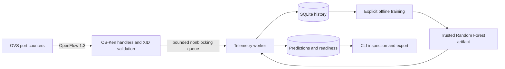

# Phase 3: live telemetry and near-future congestion detection

## Status and boundary

**COMPLETE WITH RESEARCH LIMITATIONS.** Four real Mininet/iperf3 sessions verified
collection, training, model persistence, live inference and evaluation against
subsequent observations. They produced 3,516 valid link measurements and 850
matched live forecasts. RF reduced regression errors on the independent holdout
and live session, but alert recall/F1 and steady-load performance remain limited.
No proactive routing benefit is established. Executed results and tests are in
[phase3-finalization.json](phase3-finalization.json) and
[phase3-finalization.txt](phase3-finalization.txt). Historical implementation-only results are in
[phase3-validation.txt](phase3-validation.txt) and
[phase3-validation.json](phase3-validation.json).

The owner reports successful manual Phase 2 checks. Phase 3 preserves static
base-delay forwarding and adds optional observation/prediction. It does not add
ML rerouting, telemetry-driven edge costs, React, FastAPI or another controller
framework. The Phase 1 equation remains `W = D₀ × (1 + 25 × Û⁴)`.

## Architecture and inference lifecycle



The existing controller event loop owns datapaths and topology. An OS-Ken
`hub.spawn` monitor posts a poll immediately, then every **5 seconds**. OS-Ken
4.2.2's installed native hub uses threads; the monitor waits on a threading event
for prompt stop. Handlers send requests and copy replies into a bounded queue.
They perform no SQLite writes, model training or inference. One separate native
worker owns storage, counter history, features, model loading and inference.

Telemetry is opt-in with `--telemetry-enabled`; ordinary Phase 2 startup remains
available without it. `--telemetry-db` selects storage, `--telemetry-model` selects
an optional trusted local artifact, and `--telemetry-bandwidth-scale` defaults
to 0.1. No artifact means `model_not_ready`, never fabricated forecasts. Training
is explicit and offline. If the configured model path appears or its modification
time changes, the worker loads it on the next event. There is no per-prediction
retraining. A bad artifact produces model-not-ready and an error log.

## OpenFlow collection and utilization

`OFPPortStatsRequest(datapath, 0, OFPP_ANY)` polls connected, nonfailed switches.
`EventOFPPortStatsReply` handling checks connection identity, request XID,
multipart completion and a **4-second** response deadline. Incomplete rounds are
finalized at the next poll. Old/unsolicited replies are ignored; duplicate ports
across multipart chunks invalidate that switch's round. Topology changes cancel
pending rounds and reset affected histories.

Collect `tx_bytes`, `rx_bytes`, `tx_packets`, `rx_packets`, `tx_dropped`,
`rx_dropped`, `tx_errors`, `rx_errors`, and port lifetime from `duration_sec` plus
`duration_nsec`. Unsupported all-ones 64-bit counters become null. Local/reserved
and unmapped ports are excluded. Host-facing ports are recorded as `kind=host`;
inter-switch ports as `kind=inter_switch`. Wiring comes from the existing
`TopologyState.graph`/`link_ports`, without another topology definition.

Stable physical link IDs sort DPIDs: backbone `s2-s5`, ring edge R6–R1 `s1-s6`.
For successive valid port samples, using actual monotonic receipt times:

```text
elapsed = current_monotonic_time - previous_monotonic_time
tx_mbps = 8 × Δtx_bytes / elapsed / 1,000,000
rx_mbps = 8 × Δrx_bytes / elapsed / 1,000,000
direction_utilization = tx_mbps / capacity_mbps
link_utilization = max(utilization_A_to_B, utilization_B_to_A)
```

Both TX directions remain separate. RX is diagnostic and a feature; it is **not
added to TX**, and one endpoint's TX is not added to the peer's RX. Both
directions must be valid and sampled within 2 seconds of one another to form a
valid aggregate. Aggregate time is the later receipt, when both values are
available. Aggregate TX/RX fields belong to the busiest TX direction.

Capacity is conceptual topology capacity multiplied by the configured Mininet
scale: default **100 Mbps ring links, 200 Mbps backbone, 100 Mbps host links**.
Do not divide lab rates by 1000/2000 Mbps. If Mininet uses another
`--bandwidth-scale`, supply the same `--telemetry-bandwidth-scale` to OS-Ken.
Capacity is configured, not discovered from counters. The existing Mininet runner
verifies applied TC rate/delay. Response receipt times are not synchronized
hardware timestamps; response latency can affect short-window rate accuracy.

| Condition | Recorded behavior |
| --- | --- |
| First sample/new connection | `initial`; counters retained, rates/utilization null |
| Missing/late/error/duplicate-port reply | Invalid status; baseline cleared; no zero substitution |
| Counter decrease/shorter lifetime | `counter_reset`; current counters become a new baseline |
| Unchanged lifetime | `stale_counters`; cached statistics are not fresh idle traffic |
| Nonpositive/nonfinite elapsed time | `invalid_elapsed`, no rate |
| Gap over 10 s | `sampling_gap`, reset baseline |
| Inactive link/disconnected port or switch | Invalidate/reset affected history and warning status |
| Endpoint skew over 2 s | Invalid aggregate, directional diagnostics retained |
| Above-capacity rate | Preserve raw utilization above 1, flag `capacity_exceeded`, keep a separate [0,1] operational value |
| Empty history/no model/model failure | Explicit readiness/error status and null forecast/warning |
| Queue full/disk failure | Log dropped batch or disable failed worker; forwarding continues |

OS-Ken 4.2.2's native hub can delay DEAD dispatch after closing a receive socket.
Telemetry ticks inspect negative socket file descriptors and call the normal
`datapath.close()`/Phase 2 state-change path for already-closed connections. This
does not probe live sockets or detect silent remote-link faults.

## Dataset schema, sessions and provenance

Default storage is `data/telemetry.sqlite`. Each worker start creates a UUID
session, even when reusing a DB. Do not join different sessions' monotonic clocks.
Raw, directional, aggregate and prediction records commit as one atomic batch
using SQLite WAL and `synchronous=FULL`. Graceful shutdown drains the queue with
bounded waits. Forced termination may lose an in-flight/uncommitted round, but
does not make an incomplete transaction valid. Archive a stopped DB or use
SQLite's backup facility; copying only an active WAL database's main file is unsafe.

Each record table has SQL columns `id`, `session_id`, `observation_timestamp`,
`link_id`, `record_json`. JSON retains the detailed schema. `sessions` contains
`session_id`, `started_timestamp`, `source`, `schema_version`, `config_json`
(cadence, horizon, scale, utilization policy and model path).

| Record table | JSON fields beyond common session/source/schema/timestamp/link ID |
| --- | --- |
| `raw_ports` | `poll_id`, `source_dpid`, `source_port`, `kind`, `capacity_mbps`, `monotonic_time`, `monotonic_elapsed_time`, `duration`, `counters`, `tx_mbps`, `rx_mbps`, `utilization`, `operational_utilization`, `packet_drop_rate`, `port_error_rate`, `link_active`, `valid`, `status` |
| `directions` | Raw-port fields plus `destination_dpid`, `destination_port`; one record per physical link direction |
| `observations` | `poll_id`, `source_dpid`, `destination_dpid`, `source_port`, `destination_port`, `capacity_mbps`, `active`, `link_active`, `monotonic_elapsed_time`, `tx_mbps`, `rx_mbps`, `utilization`, `operational_utilization`, `valid`, `status` |
| `predictions` | `target_timestamp`, `target_monotonic_elapsed_time`, `prediction_horizon_seconds`, `current_utilization`, `predicted_utilization`, `raw_predicted_utilization`, `congestion_threshold`, `congestion_predicted`, `model_version`, `status`; optional inference `error` |

`counters` holds the eight raw fields listed above. Drop/error rates are
packets/events **per second**, summing the available TX/RX deltas at that port;
they are null if either required counter is unsupported. They are not utilization
ratios and are not current model features. Session elapsed time starts at the
first queued event; original UTC timestamps remain independent. Duplicate or
decreasing elapsed times within a stored stream are rejected. Incomplete
observations cannot be marked valid.

Sources are explicit: `live_mininet` by controller default, `simulated_openflow`
for wire tests, `synthetic` for generated fixtures. Provenance is an operator
declaration, not automatic emulator detection. Training rejects mixed/unexpected
sources; model loading requires matching provenance. No synthetic model is
silently supplied for live operation.

In a normal shell from `~/Flowrider`:

```bash
~/.pyenv/versions/3.10.16/bin/python phase3.py sessions data/telemetry.sqlite
~/.pyenv/versions/3.10.16/bin/python phase3.py inspect data/telemetry.sqlite --table observations
~/.pyenv/versions/3.10.16/bin/python phase3.py inspect data/telemetry.sqlite --table directions --limit 14
~/.pyenv/versions/3.10.16/bin/python phase3.py inspect data/telemetry.sqlite --table predictions
~/.pyenv/versions/3.10.16/bin/python phase3.py export data/telemetry.sqlite --table observations --output /tmp/flowrider-observations.csv
~/.pyenv/versions/3.10.16/bin/python phase3.py export data/telemetry.sqlite --table raw_ports --output /tmp/flowrider-raw.jsonl
```

`inspect` defaults to the latest session and latest values per link/endpoint;
use `--session SESSION_ID` or `--history --limit 50` as needed. Replace session
placeholders with IDs from `sessions`. Latest views add inspection age/status:
old warnings marked stale are not active operational advice. CSV nulls are empty
fields, not zero; JSONL retains nulls. Read commands never create missing DBs.

## Features and +15-second labels

The ten baseline inputs, in fixed order, are current utilization; utilization
near t−5, t−10 and t−15 seconds; mean of those four values; slope
`(current−oldest)/actual_elapsed`; population standard deviation of those four;
current busiest-direction TX Mbps, its RX Mbps, and capacity Mbps.

Only observations available at or before time t can enter features. Nearest lag
samples must be within ±2 s of the nominal lag. Features group by session/link;
invalid/inactive rows, gaps over 7 s, or wall/monotonic clock discontinuities break
training segments. There is no future interpolation, imputation or scaler.

The label is actual raw aggregate utilization near **t+15 measured elapsed
seconds**, within ±2 s, strictly future and in the same uninterrupted segment.
Absent future targets are excluded; current utilization is never copied to
invent a label. Retain the matched label's actual timestamp/elapsed time separately
from the nominal prediction target. This is an experimental forecasting horizon,
not an exact onset-time estimate or a three-row array shift.

## Random Forest training, chronological split and baseline

`traffic_engine.train_live_predictor()` provides the separate live-data workflow.
Original Phase 1 functions remain available. A pooled `RandomForestRegressor`
produces individual link forecasts using each link's own features/capacity:
100 trees, `min_samples_leaf=2`, `random_state=42`, `n_jobs=1`; other defaults are
saved in metadata. There is no preprocessing fitted on the holdout.

The default test set is the latest 20% of distinct example timestamps, keeping
all links at a timestamp together. Training labels must satisfy
`train_label_time < earliest_test_time − 15 − 2`, before the earliest tolerated
test-history window. Combined with future-label alignment this purges a history-
plus-horizon gap. No random time shuffle is used.

Prefer a separate later experiment with `--holdout-session`: its examples test
the model and only earlier eligible examples from other sessions train it.
Minimums are 60 training/20 test examples **after filtering and purge**. Those are
software minimums, not scientific sufficiency. Do not lower them to get a green
command or assume ten minutes of idle traffic is sufficient.

Train explicitly after collection, while the controller can keep recording:

```bash
~/.pyenv/versions/3.10.16/bin/python phase3.py train data/telemetry.sqlite --model models/live-rf.pkl
```

For independent experiment databases, replace the holdout placeholder:

```bash
~/.pyenv/versions/3.10.16/bin/python phase3.py train data/experiment-a.sqlite data/experiment-b.sqlite \
  --model models/live-rf.pkl --holdout-session HOLDOUT_SESSION_ID
```

The `.pkl` contains model and metadata and is atomically replaced. Adjacent
`.metadata.json` reports feature order, source, versions, parameters, horizon,
tolerance, dataset hash, train/test session IDs/counts/boundaries, positive counts
and evaluation. `.features.jsonl` and `.labels.jsonl` separately preserve inputs
and targets, joined by `example_id`, with `train`, `test` or `purged` partition.
Only load trusted local pickle artifacts: pickle can execute code. Exact sklearn
version matching and source/schema checks are enforced. Synthetic tests require
explicit `--source synthetic`; those artifacts cannot load as `live_mininet`.

## Evaluation metrics and matured predictions

RF and persistence (`future = current utilization`) use the same holdout.
Report MAE, RMSE, R² when target variance permits it, congestion precision/recall/F1,
and false alarm rate `FP/actual_negative_count`. Positive, negative and predicted-
positive counts accompany metrics. Actual future utilization >=0.80 defines
congestion, with the same configurable threshold for predictions. With no positive
events, congestion-specific metrics are null/unavailable; no negatives makes
false alarm rate unavailable too. Idle-link dominance can make regression scores
misleading. No baseline superiority is assumed.

The executed independent synthetic fixture used 294 training examples and 174
held-out examples, with 59 positive targets in the holdout:

| Metric | Random Forest | Persistence |
| --- | --- | --- |
| MAE | 0.1303 | 0.0774 |
| RMSE | 0.1877 | 0.1498 |
| R² | 0.6350 | 0.7675 |
| Congestion precision | 0.8000 | 0.8448 |
| Congestion recall | 0.5424 | 0.8305 |
| Congestion F1 | 0.6465 | 0.8376 |
| False alarm rate | 0.0696 | 0.0783 |

Persistence had lower MAE/RMSE on this **synthetic-only mechanical check**. This
does not establish live performance. The two generated sessions use independent
seeds 17 and 29 with different time ranges; the exact generator is retained in
[evaluate_phase3_fixture.py](../tests/evaluate_phase3_fixture.py). Reproduce it:

```bash
~/.pyenv/versions/3.10.16/bin/python tests/evaluate_phase3_fixture.py
```

The saved model is fitted only on training rows, not refitted on its test set.
Collect multiple varied sessions, inspect positive events per experiment/link,
and use independent later holdouts. Repeating one deterministic pattern across
training/testing is not evidence of generalization.

After predictions have accumulated and their targets matured:

```bash
~/.pyenv/versions/3.10.16/bin/python phase3.py evaluate data/telemetry.sqlite --session SESSION_ID
```

This groups results by source/model version and matches valid predictions with
subsequent causally aligned labels, comparing raw regression output and raw actual
utilization. Persistence is scored on the same pairs. No matured pairs is an
error, not a fabricated metric. Use a new independent inference session to assess
generalization; replaying a period used for training is not an unbiased test.

## Independent-session research validation

The research workflow reuses the existing controller, sampler, SQLite schema,
feature engineering, training and inference. It adds an offline experiment
report and a controlled Mininet collector. No additional service, controller
framework, automatic retraining or forwarding policy is introduced.

Run from a normal-user Ubuntu terminal with sudo authentication available:

```bash
cd ~/Flowrider
# Matplotlib is already an existing project dependency; needed only for plots.
~/.pyenv/versions/3.10.16/bin/python -m pip install 'matplotlib>=3.7,<4'
bash scripts/run_phase3_research.sh
```

The runner uses port **16653**, starts and stops only its own controllers and
Mininet networks, and refuses existing switch/interface names. An unrelated
controller on port 6653 is left alone. iperf3 servers run only inside the lab;
no system iperf3 daemon is needed. Do not run a second experiment concurrently.

Default traffic time is 600 seconds **per session**, plus topology startup,
ping checks, client handshakes and 20 seconds for final targets to mature. Four
sessions therefore take over 40 minutes. Absence of errors during a traffic
stage is not completion. The terminal must return after printing
`Experiment finished. Evidence: ...`. A failed stage stops the runner and
retains partial evidence. Do not rerun an already active experiment.

For a new, explicitly separate experiment, overrides are available:

```bash
FLOWRIDER_SESSION_SECONDS=900 FLOWRIDER_CONTROLLER_PORT=16653 \
  bash scripts/run_phase3_research.sh data/research-new-experiment
```

Use a fresh output directory. A fixed duration never guarantees sufficient
training data. The collector requires measured pre-congestion and congestion,
coverage of all seven links, fresh telemetry and successful `pingall`. Training
requires at least 60 training, 20 validation and 20 test labels, with both
congestion classes in every partition. These are execution safeguards, not
statistical power or generalization guarantees.

### Traffic protocol

Seeds 17, 29 and 43 control three independent sessions, with separate controller
processes, SQLite databases and random stage ordering, timing and rates. Each
session includes low (5–15 Mbps), medium (35–55 Mbps), high (88–95 Mbps), ramps
(20, 40, 60, 78, 93 Mbps), short bursts (8–15 seconds alternating low/high), and
recovery (3–12 Mbps). Stages repeat with new randomized settings until the
requested duration. Every stage launches two concurrent UDP flows, h1→h4 and
h3→h6, or both reverse directions. The random direction is recorded.

Both paths use the backbone. Ring links are 100 Mbps and the backbone 200 Mbps.
Two same-direction 95 Mbps application flows should generate about 190 Mbps
plus overhead on the backbone, not 380 Mbps. OVS measurements include packet
overhead, while iperf3 reports application payload. The two unused ring edges
remain useful idle controls; inspect per-link results to avoid letting idle
samples dominate interpretation.

`traffic-SEED/traffic.json` preserves seeds, offered rates, endpoints, requested
durations and actual UTC stage boundaries. Individual iperf3 JSON files retain
intervals, actual sender/receiver throughput and loss. `collection-SEED.log`
contains actual TC settings and connectivity outcomes. Controller logs and
SQLite retain measured observations and readiness/prediction records.

### Frozen model-selection and evaluation protocol

The earliest session(s) train the candidates, the next session validates, and
the latest is the final holdout. Overlapping sessions are rejected. Boundary
purging requires earlier target timestamps to precede the next feature history
by 17 seconds. Features and labels retain the original timestamp methodology
(15-second history, +15-second future target, ±2-second tolerance).

The ten existing features are retained. Four fixed Random Forest candidates
use 100 trees, seed 42 and one worker: leaf size 2; leaf size 1 with depth 12;
leaf size 5; and leaf size 2 with `max_features=0.6`. Lowest **validation MAE**
selects the candidate. Five-repeat permutation importance uses validation data
only. Correlated features can obscure their contributions; importance is a
diagnostic, not proof of causation. No preprocessing is fitted on holdout data.

The selected configuration is refitted on earlier training plus validation
data and evaluated once against session 43. Session 71 then exercises that
frozen model on new live traffic, with no refitting. All metrics compare RF and
persistence on identical pairs. Reports include MAE, RMSE, R², precision,
recall, F1, false alarm rate, positive/negative sample counts, and signed error
reduction `(persistence - RF) / persistence × 100%`. Negative reduction means
regression. Zero baseline error produces an unavailable relative percentage.

Reports also separate individual links and three descriptive holdout regimes:
steady (`|Ufuture - Unow| ≤ 0.10`); approaching congestion (`Unow < .8 ≤ Ufuture`,
which takes precedence); and remaining transitions. These groupings describe
evaluation outcomes and are never input features. Positive counts represent
correlated link observations, not independent congestion episodes.

### Artifacts and inspection

```bash
# Replace RUN with the existing experiment directory; these do not start traffic.
RUN=data/research-20261015T180515Z
cat "$RUN/evaluation/report.json"
cat "$RUN/live-matured-evaluation.json"
cat "$RUN/live-audit/audit.json"
~/.pyenv/versions/3.10.16/bin/python phase3.py sessions "$RUN/session-17.sqlite"
```

`evaluation/model.pkl` and `model.metadata.json` hold the trusted model, dataset
hash, versions, parameters, split boundaries and session IDs.
`holdout-pairs.jsonl` retains predictions with actual future labels and both
nominal and actual target timestamps. `holdout-timeseries.{png,svg}` and
`validation-features.{png,svg}` are standalone presentation artifacts labeled
with provenance. RF raw outputs and operationally clipped values stay separate.

`live-audit/audit.json` retains matched predictions and later observations,
checks unseen session identity, link/provenance/model identity, actual measured
current utilization, exact +15-second forecast timestamps, clipping and the 80%
warning rule. `live-predictions.jsonl` and `live-observations.jsonl` are exports.
The fourth session also executes Phase 2 fault/recovery checks and ping tests.
Mock-based ML failure isolation remains distinct from actual live validation.

For already collected, frozen datasets, offline reproduction commands are:

```bash
~/.pyenv/versions/3.10.16/bin/python research_phase3.py \
  "$RUN/session-17.sqlite" "$RUN/session-29.sqlite" "$RUN/session-43.sqlite" \
  --output data/separate-offline-report
~/.pyenv/versions/3.10.16/bin/python research_phase3.py "$RUN/inference-71.sqlite" \
  --audit-model "$RUN/evaluation/model.pkl" --output data/separate-inference-audit
```

Do not tune repeatedly against this final holdout. Any later model changes
require a new independent final session. Synthetic smoke-test artifacts under
`data/synthetic-research-smoke/` test the reporting/plotting machinery only; the
repeated sinusoid there does not establish forecast usefulness.

### Current execution evidence

The completed real run is `data/research-20261015T180515Z`. Three collection sessions
and a fourth frozen-model inference session completed. No traffic experiment
was rerun during inspection. All measurements below come from OVS and Mininet,
not synthetic generation. The model is `rf-b6f2c2909490`, trained at
`2026-10-15T18:37:07.130617Z` with 100 trees, leaf size 2, `max_features=0.6`,
seed 42 and one worker. The independent-session selection used 833 training,
833 validation and 826 final-test examples, with 225, 220 and 215 positive
labels respectively. The final artifact refits on 1,666 earlier examples.

Training's latest target precedes the earliest holdout observation by 29.39
seconds, exceeding the 17-second purge requirement. The last two idle ring
links contribute no positive events, so their congestion metrics are null.

| Independent holdout metric | Random Forest | Persistence |
| --- | ---: | ---: |
| MAE (utilization ratio) | 0.144259 | 0.183806 |
| RMSE (utilization ratio) | 0.258560 | 0.335635 |
| R² | 0.539436 | 0.223929 |
| Congestion precision | 0.761905 | 0.604651 |
| Congestion recall | 0.446512 | 0.604651 |
| Congestion F1 | 0.563050 | 0.604651 |
| False alarm rate | 0.049100 | 0.139116 |

RF reduced holdout MAE by **21.52%** and RMSE by **22.96%**, while congestion
F1 regressed by **6.88%**. It issued fewer false alarms but missed more positive
samples. This is a mixed result, not superiority across all prediction goals.
On validation, even the selected RF had worse MAE (0.173165 versus 0.140479)
and F1 (0.561194 versus 0.681818) than persistence. Generalization varies by
session; do not select whichever evaluation looks most favorable.

| Holdout regime | Samples | RF MAE | Persistence MAE | RF F1 | Persistence F1 |
| --- | ---: | ---: | ---: | ---: | ---: |
| Steady | 481 | 0.078820 | 0.007225 | 0.562500 | 1.000000 |
| Approaching congestion | 85 | 0.284631 | 0.543625 | 0.534483 | 0.000000 |
| Other transitions | 260 | 0.219429 | 0.392847 | 0.615385 | 0.320000 |

RF correctly warned on 31 of 85 approaching-threshold samples where persistence
never warned. It also missed 65 of 110 steady positive samples that persistence
identified. There is some predictive information beyond current utilization in
this controlled holdout, accompanied by material alert and steady-load errors.
These are correlated link samples, not 31 independently predicted incidents.

Six switches connected and `pingall` returned 30/30 in each completed session.
All seven links have valid measurements. Two 7 Mbps payload flows produced
about 7.2 Mbps on each loaded ring edge and 14.4 Mbps on the backbone; high
traffic reached utilization near 0.98. One requested 95 Mbps UDP flow measured
94.991 Mbps application payload with no reported loss. Original counter-delta
calculations independently reproduced stored throughput. Session 17's actual
future label intervals ranged from 14.985 to 15.047 seconds; median directional
TX-versus-partner-RX discrepancy was 0.0131%. Its SQLite integrity check passed.

| Session/seed | Role | Traffic seconds | Valid link samples | Labeled examples | Positive labels |
| --- | --- | ---: | ---: | ---: | ---: |
| 17 | Initial training | 600 | 875 | 833 | 225 |
| 29 | Validation | 600 | 875 | 833 | 220 |
| 43 | Final offline holdout | 600 | 868 | 826 | 215 |
| 71 | Frozen-model live inference | 600 | 898 | 850 | 195 |

There were **3,516 valid measurements**, 855 threshold-positive measurements,
255 pre-congestion measurements (60–80%), and 220 completed iperf3 flows across
110 stages. Every session covered all seven physical links and all six scenario
families. Requested traffic totaled 40 minutes. Collection plus target maturation
totaled 41 minutes 46 seconds; the observed end-to-end wall span was 42 minutes
45 seconds, including starts and live fault/recovery checks. UDP loss was zero in
the first three sessions and at most 0.01524% in an individual final-session flow.
This is principally a utilization-threshold experiment, not a saturation/loss study.

The first three sessions recorded unavailable-model statuses without disrupting
forwarding. In session 71, the frozen artifact loaded, **871 valid forecasts**
were logged and **850** matched later valid targets. Twenty-one tail forecasts
lacked subsequent targets and were excluded. Twenty-seven valid telemetry
samples lacked sufficient history, particularly around startup/fault recovery.
The full Phase 2 backbone failure/recovery and partition/recovery checks passed.
All initial/final `pingall` checks passed; the final result was 30/30.

| Actual live-inference metric, 850 matched pairs | Random Forest | Persistence |
| --- | ---: | ---: |
| MAE | 0.166018 | 0.186484 |
| RMSE | 0.280882 | 0.323744 |
| R² | 0.415509 | 0.223513 |
| Congestion precision | 0.595745 | 0.564103 |
| Congestion recall | 0.574359 | 0.564103 |
| Congestion F1 | 0.584856 | 0.564103 |
| False alarm rate | 0.116031 | 0.129771 |

RF reduced live MAE by **10.97%**, RMSE by **13.24%**, and improved F1 by
**3.68% relative**. However, it missed 83 of 195 positive link samples; these
alerts are not sufficiently reliable to treat as guarantees. There were 44
correct pre-congestion warnings among 85 approaching-threshold samples, compared
with none for persistence by definition. Those warning/observation pairs led
the first subsequently observed 80% crossing by 5.001–15.003 seconds (median
15.000). They involve six crossing-time groups across correlated links, not 44
independent predicted incidents. These are observation-to-crossing intervals in
five-second averages, not exact congestion onset times or measured publication latency.

One actual matched backbone forecast:

```json
{
  "link_id": "s2-s5",
  "observation_timestamp": "2026-10-15T18:41:55.349668Z",
  "target_timestamp": "2026-10-15T18:42:10.349668+00:00",
  "current_utilization": 0.6175267210,
  "predicted_utilization": 0.8019764836,
  "congestion_predicted": true,
  "actual_target_timestamp": "2026-10-15T18:42:10.351231Z",
  "actual_future_utilization": 0.8025016825,
  "model_version": "rf-b6f2c2909490",
  "source": "live_mininet"
}
```

The independent saved-evidence audit reproduced both metric sets exactly and
verified all four SQLite databases, link/port mappings, directional maximum
aggregation, capacities, timestamps, model identity and **19,932** TX/RX
counter-rate calculations. No inference/storage failures were logged. Model
unavailability was exercised live; thrown ML/storage failures were tested with
automated tests, not injected into the live experiment. Pipeline source hashes
match the protocol captured before holdout. All four owned networks stopped;
no lab interfaces remained. The original controller on port 6653 was untouched.
Raw evidence, model and audit script remain in the run directory. Aggregated
research evidence is retained in [phase3-finalization.json](phase3-finalization.json).
Separate engineered artifacts are `evaluation/features.jsonl` and
`evaluation/labels.jsonl`, with common example IDs and train/validation/test
partitions. Regenerate them without fitting or generating traffic:

```bash
~/.pyenv/versions/3.10.16/bin/python "$RUN/export_engineered_data.py"
~/.pyenv/versions/3.10.16/bin/python "$RUN/audit_saved_evidence.py" "$RUN"
```

### Validation-only weakness investigation

These exploratory diagnostics use **only sessions 17 and 29**. They do not
select against session 43 or session 71 and do not save/promote another model.
Run against the existing artifacts:

```bash
~/.pyenv/versions/3.10.16/bin/python tests/analyze_phase3_validation.py \
  --training "$RUN/session-17.sqlite" --validation "$RUN/session-29.sqlite" \
  --research-report "$RUN/evaluation/report.json" \
  --output "$RUN/validation-diagnostics.json"
```

All comparisons use 749 common training and 749 common validation observations,
60-second available history and a 62-second boundary purge. Horizon labels use
nearest genuinely future measurements within ±2 seconds; no interpolation.
Each experiment uses the selected RF parameters with seed 42, trained only on
the earlier session. These counts differ from the main evaluation because the
longest horizon and longest history determine the common eligible samples.

| Horizon | RF MAE | Persistence MAE | RF RMSE | Persistence RMSE | RF F1 | Persistence F1 |
| --- | ---: | ---: | ---: | ---: | ---: | ---: |
| 5 s | 0.0719 | 0.0580 | 0.1321 | 0.1557 | 0.8191 | 0.8837 |
| 10 s | 0.1368 | 0.1058 | 0.2579 | 0.2371 | 0.5804 | 0.7674 |
| 15 s | 0.1576 | 0.1426 | 0.2959 | 0.2771 | 0.6018 | 0.6977 |
| 30 s | 0.2049 | 0.2064 | 0.3451 | 0.3309 | 0.5449 | 0.5238 |

Fifteen seconds remains an experimental setting; these data do not establish it
as optimal. Short horizons are easier, but persistence remains competitive.
Unannounced short bursts and transitions within a 15-second horizon are hard
to forecast from recent counters alone.

| Feature ablation at 15 s | Validation MAE | RMSE | F1 |
| --- | ---: | ---: | ---: |
| Current utilization only | 0.1533 | 0.2625 | 0.5015 |
| Four causal utilization lags | 0.1247 | 0.2229 | 0.7196 |
| Existing ten features | 0.1576 | 0.2959 | 0.6018 |
| Ten + 30/60 s lags, 60 s mean/variability/slope | 0.1390 | 0.2494 | 0.6761 |
| Persistence on the same pairs | 0.1426 | 0.2771 | 0.6977 |

Validation permutation importance gives the largest MAE increases to current
utilization, lag 5 s and lag 10 s (0.0943, 0.0376 and 0.0244 respectively).
Permuting lag 15 s improved MAE by 0.0075; mean, RX and capacity had little
measured contribution in this dataset. TX is algebraically redundant with
utilization and capacity. Correlation limits interpretation, but the lag-only
ablation is a concrete candidate for a **new independent experiment**.
It has not replaced the frozen ten-feature model or been evaluated/promoted
using the already inspected final holdout. Longer history is not consistently
better. No deep-learning model or new runtime dependency was introduced.

Presentation plots retain actual live provenance:
[directional telemetry](phase3-results/live-telemetry-17.png),
[per-link holdout forecasts](phase3-results/holdout-timeseries.png), and
[validation feature sensitivity](phase3-results/validation-features.png).
Matching SVG files in `docs/phase3-results/` support vector export.

## Prediction output and readiness

One newly processed observation produces a forecast or readiness record. A
ten-second backlog age guard suppresses stale inference. Inactive/invalid links
have null forecasts and warnings, not a valid `false` congestion result. The
target timestamp is observation time +15 s; the model does not regress timestamps.
Raw model output is retained before operational clipping to [0,1].

Illustrative schema only, **not a measured result**:

```json
{
  "link_id": "s2-s5",
  "observation_timestamp": "2026-10-15T10:00:00Z",
  "target_timestamp": "2026-10-15T10:00:15+00:00",
  "prediction_horizon_seconds": 15,
  "current_utilization": 0.64,
  "raw_predicted_utilization": 0.91,
  "predicted_utilization": 0.91,
  "congestion_threshold": 0.8,
  "congestion_predicted": true,
  "model_version": "rf-illustration",
  "source": "live_mininet",
  "status": "valid"
}
```

Console output includes `[FlowRider ML]`, link, current/predicted percentages,
`(+15s)`, target timestamp and `Congestion warning: YES/NO`. Otherwise it reports
statuses such as `initial`, `model_not_ready`, `insufficient_history`, `inactive`,
`stale_measurement` or `inference_error`. Structured output is SQLite/CLI, not a
new web application.

## Manual Mininet verification: three terminals

Use the existing Ubuntu/WSL, Mininet, OVS and OS-Ken setup. Python 3.10.16 runs
the controller/ML; Ubuntu's `/usr/bin/python3` runs Mininet. Tested ML versions
are NumPy 1.26.4 and sklearn 1.7.2. No new virtual environment is required.
If dependencies are missing, install only those needed:

```bash
cd ~/Flowrider
~/.pyenv/versions/3.10.16/bin/python -m pip install -r requirements-ml.txt
command -v iperf3
sudo ovs-vsctl list-br
```

Arrange iperf3 installation with an authorized administrator if absent. Do not
install Ryu or Ubuntu's `python3-os-ken`. Inspect existing bridge ownership before
cleanup and avoid global destructive cleanup.

1. **Terminal 1 — controller/collector.** The model may not exist initially:

   ```bash
   cd ~/Flowrider
   ~/.pyenv/versions/3.10.16/bin/python -u controller.py \
     --ofp-listen-host 127.0.0.1 --ofp-tcp-listen-port 6653 \
     --telemetry-enabled --telemetry-db data/experiment-a.sqlite \
     --telemetry-model models/live-rf.pkl --telemetry-bandwidth-scale 0.1
   ```

2. **Terminal 2 — network.** Keep the controller running:

   ```bash
   cd ~/Flowrider
   sudo /usr/bin/python3 mininet_topology.py --bandwidth-scale 0.1
   ```

   At `mininet>`, run `pingall`: expect `0% dropped`, six switches and seven
   active links. Confirm `Telemetry session=...` and `source=live_mininet` in
   Terminal 1. Roughly two rounds are needed for rates; predictions additionally
   need a valid model and at least 15 s of valid rate history.

3. **Terminal 3 — inspect and train.** Use `phase3.py inspect` commands above.
   Confirm capacity 100/200, valid timestamps, two directions per link and rates
   responding to the real traffic below. At `mininet>`, independently inspect
   `sh ovs-ofctl -O OpenFlow13 dump-ports s2` and
   `sh tc class show dev s2-eth4`. A requested iperf rate is not a measurement.

4. Collect varied independent sessions. Train explicitly; inspect retained sample
   counts, positive events and baseline metrics. Insufficient labels/events require
   more suitable collection, not a claim of perfect warning performance.

5. A saved model at the configured path loads without restarting Mininet. Inspect
   model version, target timestamps, statuses and threshold flags. Wait at least
   one horizon plus tolerance, then run `evaluate` for the actual inference session.
   Record false alarms and persistence performance as well as successes.

6. Run `pingall` again and Phase 2 link-failure/restoration checks if desired.
   Down-link histories must reset; forecasts after restoration require new valid
   history. Predictions must not change static forwarding weights or policies.

7. Stop only your traffic, enter `exit` in Mininet, inspect owned bridge cleanup
   with `sudo ovs-vsctl list-br`, then stop the controller with Ctrl-C. Archive
   data/logs/model reports. Restart with a different experiment DB/traffic plan;
   never join session monotonic clocks.

## Controlled iperf3 traffic generation

Run only inside this Mininet lab. Host access links are 100 Mbps: one h2→h5
flow cannot saturate a 200 Mbps backbone. Concurrent h1→h4 and h3→h6 flows both
use s2→s5 under static delay routing and can jointly congest it. IP/application
rates and OpenFlow byte rates can differ because of framing and polling windows.

Start servers at `mininet>` and retain their own PIDs:

```text
h4 sh -c 'iperf3 -s -p 5201 >/tmp/flowrider-h4-server.log 2>&1 & echo $! >/tmp/flowrider-h4-server.pid'
h6 sh -c 'iperf3 -s -p 5201 >/tmp/flowrider-h6-server.log 2>&1 & echo $! >/tmp/flowrider-h6-server.pid'
```

| Regime | Command at `mininet>` | Observation to check |
| --- | --- | --- |
| Low | `h1 iperf3 -c 10.0.0.4 -u -b 10M -t 60 -i 5` | Low nonzero rates |
| Medium | `h1 iperf3 -c 10.0.0.4 -u -b 50M -t 60 -i 5` | Roughly half a ring link, not half the backbone |
| High on a ring path | `h1 iperf3 -c 10.0.0.4 -u -b 95M -t 90 -i 5` | Measured ring utilization >=0.8 |
| Concurrent backbone load | Start `h1 iperf3 -c 10.0.0.4 -u -b 95M -t 90 -i 5 >/tmp/flowrider-h1-high.log 2>&1 &`, then `h3 iperf3 -c 10.0.0.6 -u -b 95M -t 90 -i 5` | Combined forward TX load on backbone; do not sum opposite directions |
| Reduction/recovery | After high clients finish, `h1 iperf3 -c 10.0.0.4 -u -b 10M -t 60 -i 5`, then allow 30 s idle | Rates fall; compare forecasts with later actuals |

Gradual ramp:

```text
h1 sh -c 'for rate in 10 30 50 70 95; do iperf3 -c 10.0.0.4 -u -b "${rate}M" -t 40 -i 5; done'
```

Sudden burst with low-traffic context and recovery:

```text
h1 sh -c 'iperf3 -c 10.0.0.4 -u -b 10M -t 60 -i 5; iperf3 -c 10.0.0.4 -u -b 95M -t 20 -i 5; iperf3 -c 10.0.0.4 -u -b 10M -t 60 -i 5'
```

Do not reuse the same deterministic schedule as the only training and test data.
For a later held-out experiment, vary ordering, durations, rates and background
flow offsets: for example 35/85/15/95/55 Mbps for 65/35/80/45/70 seconds, with
h3→h6 overlapped differently. Record plans/seeds, outputs and session UUIDs.
Use `--holdout-session` for the later session. Dataset adequacy requires valid
future targets, varied conditions and positive events in both train and test;
duration or total idle rows alone is insufficient.

Let finite clients finish. Before stopping servers, check the stored PIDs:

```text
h4 sh -c 'ps -p "$(cat /tmp/flowrider-h4-server.pid)" -o pid,args'
h6 sh -c 'ps -p "$(cat /tmp/flowrider-h6-server.pid)" -o pid,args'
```

Only if these still identify your servers:

```text
h4 sh -c 'kill "$(cat /tmp/flowrider-h4-server.pid)"'
h6 sh -c 'kill "$(cat /tmp/flowrider-h6-server.pid)"'
```

Do not use system-wide `pkill iperf3`: Mininet can share the host PID namespace.
The automated test instead owns and terminates its specific subprocesses.

## Automated tests and real live acceptance

Unprivileged checks, including actual TCP with **simulated** peers:

```bash
~/.pyenv/versions/3.10.16/bin/python -m unittest discover -s tests -v
/usr/bin/python3 -m unittest discover -s tests -p test_mininet_topology.py -v
```

The pyenv run skips five Ubuntu Mininet structure/safety tests; system Python
runs those without creating a network. Tests cover arithmetic/reset/invalidity,
direction mapping, sessions/atomicity/order, causal lags/labels/purge, metrics,
provenance, model persistence/readiness/failures, CLI exports, synthetic worker
inference and Phase 1/2 regressions. Socket tests own ephemeral controller
processes; the telemetry wire test takes about 15–20 s at the real polling cadence.
Finalization executed 89 discovered pyenv tests: 84 passed and five skipped;
all five skipped tests passed under system Python. Thus **89 distinct tests
passed, zero failures**. Captured output is in
[phase3-finalization.txt](phase3-finalization.txt). These automated tests are
separate from the actual four-session Mininet evidence above.

For **real Mininet acceptance**, start Terminal 1 with matching absolute paths:

```bash
cd ~/Flowrider
~/.pyenv/versions/3.10.16/bin/python -u controller.py \
  --ofp-listen-host 127.0.0.1 --ofp-tcp-listen-port 6653 \
  --telemetry-enabled --telemetry-db "$PWD/data/live-acceptance.sqlite" \
  --telemetry-model "$PWD/models/live-acceptance.pkl"
```

Without an interactive FlowRider network running, in another terminal:

```bash
cd ~/Flowrider
set -o pipefail
sudo /usr/bin/python3 tests/integration_phase3.py \
  --database "$PWD/data/live-acceptance.sqlite" --model "$PWD/models/live-acceptance.pkl" \
  --seconds 360 --seed 42 2>&1 | tee /tmp/flowrider-phase3-live.log
```

This reuses Phase 2 live checks, owns two servers and concurrent UDP clients,
varies traffic using a recorded seed, requires actual congested samples and
positive train/test events, explicitly trains through the pyenv interpreter,
waits for live model loading, evaluates matured predictions, checks threshold
logic, repeats `pingall` and verifies scoped cleanup. Insufficient data cause
failure; 360 s is only a starting duration. Repeat independent experiments with
different seeds/DBs for research; this acceptance experiment is not a skill claim.

The final success marker is `LIVE PHASE 3 TELEMETRY-TO-PREDICTION AND CLEANUP
CHECKS PASSED`, with exit status 0. Logs and training/matured-evaluation JSON go
to `/tmp/flowrider-phase3-live` by default; use `--log-dir` for separate runs and
retain the controller log. Sudo denial, missing iperf3, missing positive targets,
failed inference or alignment are not successful live validation. This older
single-session acceptance command was not executed during finalization; the
completed independent-session runner above supplies the actual live evidence.

## Limitations, completion and Phase 4 interfaces

Polling-window rates are not packet-level ground truth. Capacity/provenance must
match the experiment. Abrupt external bursts may be unpredictable from recent
history. The initial pooled feature baseline needs drift, imbalance and
generalization studies; no superiority over persistence is assumed. There is
no exact congestion-onset prediction.

SQLite grows without retention; CLI reads records into memory. The worker queue
is bounded at 64 batches and histories at 16 rows per link. Slow inference or
storage can create stale/backlogged observations; old forecasts are suppressed.
No telemetry/ML output changes routing weights or FlowMods. Existing Phase 2
limitations still apply. No frontend or API server is included.

- [x] Five-second OpenFlow polling, scaled directional utilization and invalidity handling.
- [x] Session-separated atomic storage, exports and separate feature/label artifacts.
- [x] Time-aligned +15 s targets and chronological purged holdout.
- [x] Reproducible RF, persistence metrics and null no-positive-event metrics.
- [x] Structured inference/readiness, safe loading and forwarding isolation tests.
- [x] Phase 1/2 regressions and simulated-wire tests.
- [x] Actual Mininet counters verified against controlled iperf3 here.
- [x] Independent live sessions with sufficient congested training/test targets.
- [x] Live model forecasts compared with subsequent actual utilization.
- [x] Retained live alert metrics, baseline comparison and clean restart evidence.

**COMPLETE** requires a functioning real telemetry-to-prediction pipeline with
retained evidence as well as tests. Current verdict is **COMPLETE WITH RESEARCH
LIMITATIONS**. The pipeline is verified; reliable alert generalization and
beneficial proactive routing remain research questions. Phase 4 can proceed as
controlled research with persistence and static forwarding as explicit controls.
It must measure routing delay, throughput, loss and stability before claiming
congestion avoidance. The lag-only diagnostic needs a fresh independent holdout
before promotion; it has not replaced the frozen deployed artifact.
Phase 4 can read current/historical observations and directions, latest structured
predictions, valid/recent warnings, readiness statuses, session provenance and
model metadata through SQLite, exports or existing Python functions. Null,
inactive or stale records must not be treated as safe zero congestion. Future
predictive routing can explicitly consume these outputs after validation; this
phase does not connect them to forwarding decisions.

## Files and responsibilities

| File | Responsibility |
| --- | --- |
| `controller.py` | Opt-in polling lifecycle, reply/error handling, isolated telemetry hooks and closed-socket inspection |
| `telemetry.py` | Port counter validity, scaled link mappings and directional aggregation |
| `telemetry_runtime.py` | XID/multipart rounds, bounded worker, model reload and inference orchestration |
| `telemetry_store.py` | Transactional SQLite sessions, schema checks and read access |
| `prediction.py` | Causal features/labels, chronological purge, evaluation and inference |
| `traffic_engine.py` | Additive live RF training/persistence; original simulation functions preserved |
| `phase3.py` | Offline training, sessions, inspection, exports and matured evaluation CLI |
| `collect_phase3.py` | Seeded real Mininet collection, owned iperf3 processes, stage logs and measurement-quality checks |
| `research_phase3.py` | Independent train/validation/holdout protocol, fixed RF comparisons, diagnostic plots and frozen-model inference audit |
| `scripts/run_phase3_research.sh` | Authenticated-terminal orchestration of three collection sessions and a fourth inference session |
| `requirements-ml.txt` | Existing NumPy/sklearn requirements plus controller runtime |
| `.gitignore` | Exclude local experiment/model artifacts |
| `README.md` | Phase 3 entry points and accurate verification status |
| `tests/test_telemetry.py` | Sampling, aggregation and storage tests |
| `tests/test_prediction.py` | Causal alignment, splits, metrics, model and readiness tests |
| `tests/test_telemetry_runtime.py` | Poll/worker/failure tests and Phase 2 checks under telemetry failure |
| `tests/test_telemetry_socket.py` | Real controller polling/storage with simulated counter peers |
| `tests/test_phase3_cli.py` | Training/export/inspection/evaluation CLI tests |
| `tests/test_phase3_research.py` | Whole-session separation, holdout isolation, audit safeguards and reproducible traffic schedules |
| `tests/analyze_phase3_validation.py` | Exploratory training/validation-only horizon and feature ablations; never promotes a model |
| `tests/test_phase3_diagnostics.py` | Genuine future targets and causal longer-history diagnostics |
| `tests/test_phase1_regression.py` | Original synthetic predictor and cost-equation regression tests |
| `tests/test_openflow_socket.py` | Preserve Phase 2 checks; extend simulated peer with an optional multipart-response hook |
| `tests/integration_phase3.py` | Opt-in real Mininet/iperf3 acceptance experiment |
| `tests/evaluate_phase3_fixture.py` | Reproduce the explicitly synthetic independent-session evaluation |
| `docs/phase3.md` | Methodology, schema, commands, limitations and checklist |
| `docs/phase3-validation.txt` | Captured test and permission outputs |
| `docs/phase3-validation.json` | Machine-readable evidence and synthetic evaluation metadata |
| `docs/phase3-finalization.json` | Actual live research metrics, dataset quality, validation diagnostics and readiness verdict |
| `docs/phase3-finalization.txt` | Captured final regression and independent saved-evidence verification outputs |
| `docs/phase3-results/` | PNG/SVG plots from actual Mininet telemetry and independent live-data holdout |

## Primary references

- [OS-Ken OpenFlow 1.3 statistics](https://docs.openstack.org/os-ken/latest/ofproto_v1_3_ref.html)
- [RandomForestRegressor](https://scikit-learn.org/stable/modules/generated/sklearn.ensemble.RandomForestRegressor.html)
- [Time-ordered validation and gaps](https://scikit-learn.org/stable/modules/generated/sklearn.model_selection.TimeSeriesSplit.html)

The implementation uses measured-time purging rather than assuming equally
spaced row indices. Installed OS-Ken native-hub behavior and message encoders
were inspected and exercised directly.
